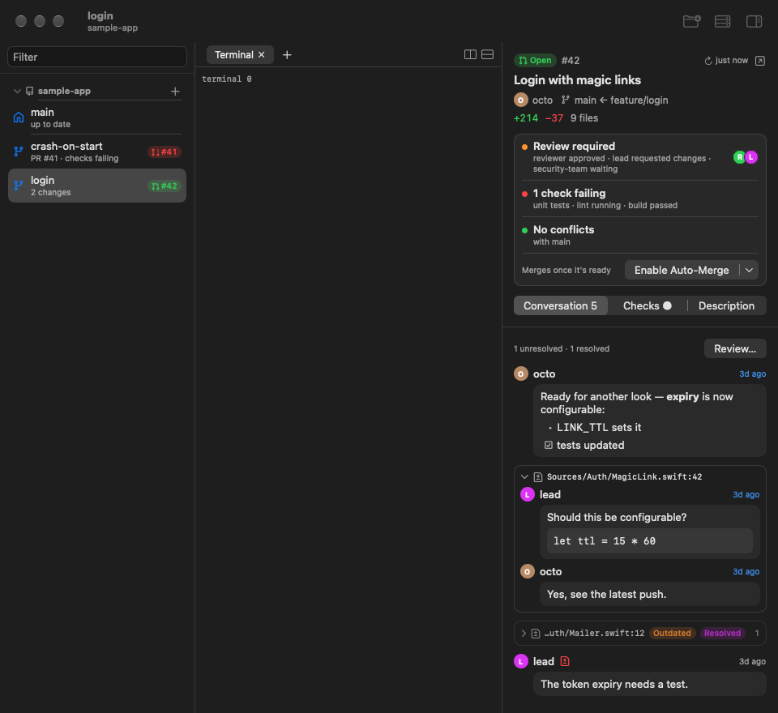
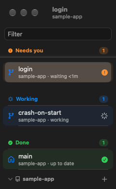
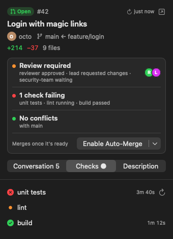
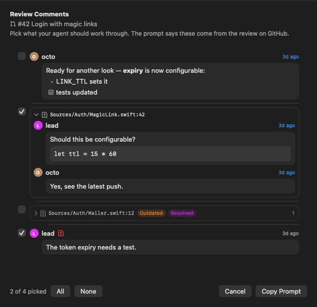
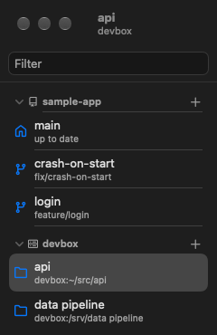
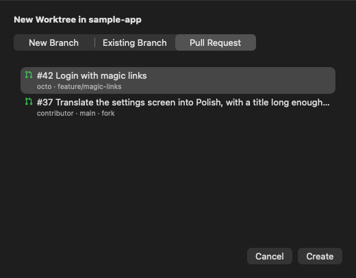
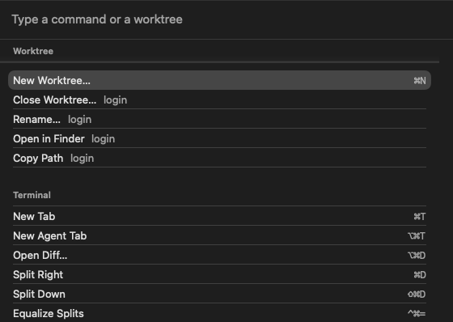

# Yatty

Yet Another TTY: a native macOS app for running coding agents in parallel, one
git worktree each. Running several agents at once means several branches,
terminals and pull requests to keep apart, and noticing when one of them is
waiting on you. Yatty keeps each worktree's terminals, git status, pull request
and diffs in one window, and floats the worktrees whose agents need you, are
working or have finished to the top of the sidebar. Every pane is a real
[Ghostty](https://ghostty.org) terminal (libghostty), kept alive by
[zmx](https://github.com/neurosnap/zmx) when Yatty quits.



## Features

### The sidebar

Repositories come first, then SSH hosts. Under each, its worktrees.



- **Projects.** A click on a project's header folds it away. Folded, it still
  shows the most urgent agent inside, an orange dot when any worktree has
  changes, and how many worktrees it has. Drag a header onto another of its
  kind to reorder them (or Worktree > Move Project Up / Down). Its **+** makes
  a new worktree, or, on a host, adds a directory. Its context menu has Remove
  Repository… (or Remove Host…): Yatty forgets it and ends its terminals, and
  touches no files.
- **Two lines per row, always.** The name, and one fact in words: the first of
  these that applies.
  1. The agent is waiting on you: `waiting 12m`.
  2. The pull request wants attention: `PR #194 · checks failing`,
     `PR #194 · changes requested`, `merged · ready to close`.
  3. The agent is working: `working`.
  4. A directory on an SSH host: `host:~/path`, or `disconnected`.
  5. Changes and sync: `13 changes · ↑2`, `↑2 ahead`, `↓18 behind`.
  6. The branch, when the name shown isn't the branch's.
  7. Otherwise `up to date` (`missing` when the directory is gone).
- **On the right**, the pull request's pill (GitHub's icon for open, draft or
  merged, and `#N`, coloured by its checks; purple once merged; a click opens
  the PR panel) and the agent's mark.
- **Hover** swaps those for ⋯ (Rename, New Worktree, Open in Finder, Copy Path,
  Close) and ✕ (Close Worktree…, or Remove Directory… on a host); neither
  closes the repository's main working copy. The same actions are in the row's
  context menu, the menu bar and the command palette.
- **Rename in place.** Double-click the name: ⏎ saves, Esc cancels, clicking
  away keeps what you typed. Only the sidebar's name changes; the branch and the
  directory stay. An empty name goes back to the branch's.
- **Filter** (⌥⌘F, or the field at the top) narrows the list to worktrees whose
  name, branch or project contains what you type.
- **Needs you, Working, Done.** A worktree whose agent needs you, is working, or
  has finished since Yatty started and you haven't looked yet, moves out of its
  project into one of three sections at the top. Each section is coloured,
  each row says which project it's from, and the longest in that state comes
  first. Once its agent goes idle, or you've seen the finished one, it sinks
  back into its project. The selected worktree keeps its place until you select
  another, so its row never moves under you. Selecting a row there leaves its
  project folded or not, as it was.
- **Drop a folder** on the sidebar to add it as a repository. ⏎ in the sidebar
  gives the keyboard back to the terminal.

### Terminals that stay

- Each worktree has tabs, and each tab a tree of splits. Every pane is its own
  zmx session, on Yatty's own socket directory, apart from any zmx of yours.
- Quit Yatty and open it again: every tab and split comes back in the same
  layout, attached to the session it had. Nothing is typed into a session that
  already exists. Terminals of worktrees you aren't looking at keep running.
- The tab bar: tabs titled by the terminal (or a name you give one:
  double-click it), a **+** menu (New Shell, New Agent, New Diff…) and split
  buttons. Drag a divider to resize. Panes without the keyboard are dimmed.
- A pane closes when its program exits. With every tab closed, the worktree
  offers a new terminal or a new agent.
- Closing a pane, tab, worktree or repository ends exactly its sessions.
  Sessions of a worktree deleted while Yatty wasn't looking are ended too.
- Yatty reads your Ghostty config (`~/.config/ghostty/config`): fonts, theme
  and keybinds apply to its terminals. A terminal key you rebind there does the
  same in Yatty.

### Agents and notifications

- **Your agent starts by itself.** The agent command (default
  `caffeinate -is claude`) is typed into a worktree's first terminal when its
  session is new, and into every New Agent tab (⌥⌘T).
- **Status.** A `claude` Yatty starts runs with Claude Code hooks (`--settings
  ~/.config/yatty/claude-hooks.json`) that report each pane's state: needs you
  (a permission prompt, a question, a plan to approve), working, done, or idle.
  Yatty watches the pane's screen too, so an agent you stopped with Esc doesn't
  stay "working". The hooks do nothing outside a Yatty terminal.
- **Track Every Claude** (Agents menu) adds the same hooks to your own
  `~/.claude/settings.json` (or `$CLAUDE_CONFIG_DIR/settings.json`), so a
  `claude` you start by hand reports too. It asks first, leaves your other
  settings alone, and takes the hooks out again when you turn it off.
- **Notifications.** When an agent needs you or finishes and you aren't looking
  at its worktree, a system notification says so; clicking it opens that
  worktree and pane. macOS asks you to allow them the first time; Settings
  turns them off.
- **⇧⌘J** goes to the next worktree, in sidebar order, whose agent needs you
  (else one that's done), with the keyboard in that agent's pane.
- Agents Yatty starts are told about the [`yatty` CLI](#the-yatty-cli) as they
  start.

### Git status and pull requests

- Every 5 seconds, and whenever an agent changes state, Yatty reads each
  worktree's git status: changed files, and how far it is ahead of or behind
  its upstream.
- For a repository on GitHub, `gh` gives each branch's pull request: the open
  one, else a merged one that was this branch's. It's asked every 60 seconds
  and when an agent changes state, only while Yatty is the active app;
  switching back to Yatty, or ⌘R, asks again.
- Worktrees made outside Yatty (by hand, by an agent) appear when you switch
  back to it. One removed outside Yatty takes its terminals with it.
- Git that Yatty runs to read a worktree (status, the diff tab, the commit
  list) switches off what the repository's own config could make it run:
  hooks, fsmonitor, external diff and textconv programs, filters the repository
  defines, signature checks. An agent can write that config, and Yatty runs
  outside any sandbox. Writes (adding a worktree, fetching a pull request) are
  plain git.

### The pull request panel

⌥⌘P, the toolbar button or a click on a row's pill shows the selected
worktree's pull request on the right of its terminals.



- **The header**, which doesn't scroll: the state (Open, Draft, Merged,
  Closed), `#N` and the title (a click opens it on GitHub), the author,
  `base ← head`, `+N −M` and the file count, a refresh button saying how long
  ago it was read, and open on GitHub.
- **The merge box**, as GitHub has under a pull request:
  - **Reviews**: the verdict (Approved, Changes requested, Review required…),
    who said what, who is still asked, and the reviewers' pictures. A click
    opens the Conversation tab.
  - **Checks**: "1 check failing", "3 checks running", "All checks passed", and
    which. A click opens the Checks tab.
  - **Conflicts**: "No conflicts with main", "Conflicts with main", or
    "Checking…".
  - **Merge.** The button merges with the method you used last; its ▾ picks
    squash, merge or rebase, whichever the repository allows. When GitHub says
    the pull request is blocked or behind and the repository allows
    auto-merge, it reads **Enable Auto-Merge**. When it can't do either (a
    draft, conflicts…), it's disabled and says why. Either way you confirm
    first: the merge is pinned to the head commit on screen, so a push you
    haven't seen isn't merged with it. Afterwards Yatty offers to close the
    worktree.
  - Once merged the box is one line, "Merged into main", with **Close
    Worktree…** (except on the main working copy); closed unmerged, "Closed
    without merging".
- **Tabs**, remembered per worktree while Yatty runs:
  - **Conversation** (with the comment count): comments, review summaries, and
    review threads under their `file:line`, newest first, markdown rendered.
    Resolved threads start folded. A click on a comment's time opens it on
    GitHub. **Review…** opens [Review Comments](#review-comments).
  - **Checks** (● when one fails): failing first, then running, passed,
    skipped, each with how long it took. A click on a name opens its log. A
    failed GitHub Actions check has a button that re-runs its failed jobs.
  - **Description**: the body, rendered, and the labels.
- While it's shown, the panel reads the pull request again every 30 seconds.
- The View menu has the rest: Merge Pull Request… (picking the method first),
  Review Comments…, Show in Pull Request Panel, Open Pull Request on GitHub,
  Re-run Failed Checks.

### Review Comments

Review… (in the Conversation tab, or View > Review Comments…) lists
everything said on the pull request, each with a checkbox. Unresolved threads,
and comments by anyone but the pull request's author, start picked; All and
None change that. It asks GitHub again as it opens, and copies only once that
answer is in.



**Copy Prompt** puts a prompt on the clipboard for you to paste into your
agent. It says the comments come from the pull request's review on GitHub, not
from a review of yours, and asks the agent to make each change or say why
not. Threads come first, by file and line, each marked unresolved, resolved,
outdated or on removed lines; then comments and reviews, oldest first. Every
comment names its author (and whether that's the pull request's author) and
its date. It starts like this:

```text
Below are comments from the review of pull request #42 "Login with magic links" on GitHub (https://github.com/me/sample-app/pull/42), feature/login into main. Reviewers left them on GitHub; they are not from a local review of mine.

Work through them in this worktree: make the change each one asks for, or tell me why it shouldn't be made.

## 1. Thread on `Sources/Auth/MagicLink.swift:42` (unresolved)

**lead** on 2026-11-06:
Should this be configurable?
```

### Diffs

Open Diff… (⌥⌘D, or New Diff… in the tab bar's **+** menu) shows:

- working changes, or staged ones;
- what the branch adds against the base branch (origin's default branch);
- a ref or a range you type (`main~3`, `v1.2`, `a1b2c3..HEAD`);
- commits picked from the branch's list: pick one to diff from it to HEAD, or
  mark a second for the range between them.

Its Viewer menu picks where, and remembers it:

- **Yatty** (the default): a diff tab of Yatty's own, beside the terminals. Unified or side by side
  (remembered), highlighted, with a file list and files that fold. Working
  changes include new files. Refresh reads it again, and so does asking for
  the same diff again (its tab comes to the front). ⌘W closes it.
  **Comments:** click a line number to leave a comment on that line (⌘↩
  saves, Esc cancels; Edit and Delete under each). They stay with the tab,
  and **Copy Prompt** puts them on the clipboard for your agent, quoting each
  line and saying it's your own review, not GitHub's. When the diff changes, a
  comment follows its line's text; one whose line is gone is listed above the
  diff as outdated (the prompt says so). A diff over 20 MB is left to a terminal
  viewer.
- **A terminal viewer**, when it's on your login shell's `PATH`: hunk,
  diffnav (with delta), delta, difftastic, lumen, nvim diffview (only when you
  pick it), or plain `git diff`. It opens in a tab of its own that closes when
  the viewer quits. An empty diff says so instead of flashing past, and pagers
  don't quit on a short one.

### Code beside the agent

Show Code (⌘E, or the **</>** button in the tab bar) puts the code on the left
of a tab and its terminals on the right, as in Cursor: for reading what your
agent writes, not for typing. With the code shown, ⌘W closes the code first,
never the agent beside it.

- **It follows the agent.** Each file that changes in the worktree opens as it
  changes, scrolled to the change. Scroll or click to look around yourself and
  it stops; **Follow** picks it up again, and a bar names the files that change
  meanwhile. Files git ignores, and other worktrees inside this one, don't count.
- **The whole file, changes in place.** Added and changed lines are marked
  green, removed ones show in red where they were. **Last Commit** marks what
  isn't committed; **vs origin/main** marks all of the branch's work.
- **Finding your way.** ⌘-click a name to go to where it's declared (a list when
  there are several); ⌘P opens a file by a few letters of its name, changed
  files first; the path bar lists the changed files, then every file.
- **Comments for the agent.** Click a line number to comment, as in the diff tab.
  A comment follows its line's text as the file changes, or is listed as
  outdated. **Send to Agent** pastes the comments not sent yet into the agent's
  terminal in that tab and submits them; **Copy Prompt** puts them all on the
  clipboard.

Going to a declaration searches the worktree (`git grep`) instead of running a
language server, which would run the repository's own code outside any sandbox.
It's for local worktrees only.

### SSH hosts

Add SSH Host (⇧⌘O) adds a directory on another machine: any host `ssh` can
reach, a `~/.ssh/config` alias included (they're offered in a menu). Its
terminals, tabs and splits run there, each in a zmx session on that host, so
they outlive a dropped connection and Yatty quitting. zmx must be installed on
the host; Yatty checks, and checks the directory exists, before adding it.



- Key logins just work. A host that asks for a password, or a key's
  passphrase, gets a field for it: it logs in once, and everything after shares
  that connection (for 10 minutes after its last use). The password is never
  stored, and Yatty never logs in to such a host in the background.
- A dropped connection leaves the pane showing what ssh said, with a
  Reconnect bar. The session is still running on the host.
- Remove Directory… and Remove Host… end the sessions there (once the host can
  be reached) and touch no files.
- Git status, agent status, pull requests, diffs and the `yatty` CLI are for
  this Mac's repositories only. A New Agent tab on a host runs plain `claude`.

### The `yatty` CLI

Every Yatty terminal on this Mac has the `yatty` command on its `PATH` (and at
`$YATTY_CLI`). It drives the tabs of the worktree it runs in, through the app,
so an agent can run a dev server in a tab of its own and read its output, show
you a diff, or ask for your attention:

```sh
yatty tab new --name dev -- npm run dev   # a tab in the background, running it
yatty tab read dev --lines 30             # what it shows
yatty tab send dev --key C-c              # stop it
yatty diff                                # working changes, in your diff viewer
yatty notify "Ready for review"           # a notification for you
```

`yatty skill install` adds a Claude Code skill that teaches it in full. All
the commands are in the [CLI reference](#cli-reference).

### Agents in fence

Yatty can work with agents running inside [fence](https://github.com/Use-Tusk/fence),
on the sandbox's terms. Yatty doesn't put an agent in fence: an agent is
fenced when its command starts it there (for example an agent command of
`fence -- claude`).

Inside fence (`$FENCE_SANDBOX` is set) the CLI talks to Yatty's sandbox socket,
the only one of Yatty's that fence should let it reach, and the app holds every
request on it to these rules:

- `yatty tab new` starts its tab in the sandbox: your sandbox command, then the
  shell. Its `--cwd` is entered inside the sandbox, so it never widens it.
- `yatty diff` opens in a terminal viewer's tab, in the sandbox. Never in
  a Yatty diff tab, whose git runs in the app; if that's your viewer, the
  first terminal viewer installed is used.
- `yatty tab send` types only into tabs started in the sandbox: never into
  your tabs, nor the panes your agents run in.
- A tab started in the sandbox stays marked: whenever its session has to
  start again, after a restart too, it starts in the sandbox.
- Without a sandbox command set, Yatty starts nothing for a fenced agent.

What isn't sandboxed:

- Yatty, and what it runs itself: zmx, git, `gh`, the diff tab, your own
  tabs (New Shell, New Agent) and agents whose command doesn't start them in
  fence.
- From the sandbox the CLI can still list, read, select, rename and close
  tabs, of any worktree Yatty knows (`--worktree`), post notifications and run
  `status`.

[Setting up fence](#setting-up-fence) has the config.

## Requirements

- macOS 26 on Apple Silicon.
- `git`. The [GitHub CLI](https://cli.github.com) (`gh`, logged in) for
  repositories from GitHub and pull requests; local folders work without it.
- To build: Xcode (Swift 6.2, the Metal toolchain) and
  [zig](https://ziglang.org) 0.17. `make deps` downloads zmx from GitHub.
- Optional: [Claude Code](https://docs.anthropic.com/en/docs/claude-code) (the
  default agent command runs `claude`), a terminal diff viewer,
  [fence](https://github.com/Use-Tusk/fence), and zmx on any SSH host you add.

## Building and running

```sh
git clone --recurse-submodules git@github.com:BeerHobbyist/yatty.git
cd yatty
make deps   # GhosttyKit (from ThirdParty/ghostty) and zmx 0.8.1 into Vendor/
make app    # build/Yatty.app; make app CONFIG=release for a release build
make run    # build it and open it
```

`make deps` does nothing when `Vendor/` is up to date; `FORCE=1
scripts/build-ghostty.sh` rebuilds GhosttyKit anyway. The bundle carries zmx,
the `yatty` CLI and its skill, Ghostty's resources and the diff tab's page,
and is signed ad hoc.

### Rebuilding while Yatty is open

`make app` deletes `build/Yatty.app` before it writes the new one, so don't
point it at the Yatty you're running. Build into another bundle, then swap it
in:

```sh
YATTY_APP="$PWD/build/next/Yatty.app" scripts/bundle-app.sh   # add `release` for a release build
# quit Yatty (⌘Q), then:
rm -rf build/Yatty.app && mv build/next/Yatty.app build/Yatty.app && open build/Yatty.app
```

Quitting Yatty doesn't end your terminals: zmx keeps every session running,
and the new Yatty attaches to them as it opens.

## Getting started

1. **⌘O** adds a repository: pick one `gh` can see (it's cloned into `~/yatty`,
   or an existing clone there is reused), or Choose Local Folder…, or drop a
   folder on the sidebar.
2. **⌘N** makes a worktree from a new branch (based on origin's default
   branch, and not tracking it), an existing branch (local or remote), or an
   open pull request (forks included). It lives in `<repo>/.worktrees/`, in a
   directory named after the branch (`feature/login` becomes `feature-login`);
   Yatty adds `.worktrees/` to the repository's `.git/info/exclude`. Its first
   terminal starts your agent. A branch that already has a worktree gets that
   one selected instead.

   

3. **⌘T** opens a tab, **⌥⌘T** one with another agent, **⌘D** / **⇧⌘D** split
   it, **⌘W** closes a pane.
4. When an agent needs you, its worktree moves to **Needs you**; **⇧⌘J** goes
   there.
5. **⌥⌘P** shows the pull request, **⌥⌘D** a diff.
6. Done with a worktree? ✕ on its row (or Worktree > Close Worktree…) deletes
   its directory, uncommitted changes included, and ends its terminals. The
   branch stays. The repository's main working copy can't be closed.
7. **⇧⌘P** finds every other action by name, with its key; **⌘?** lists every
   key.

## Keys

**Yatty**

| Key | |
|---|---|
| ⌘N | New worktree |
| ⌘O | Add repository |
| ⇧⌘O | Add SSH host |
| ⌥⌘F | Filter worktrees |
| ⇧⌘J | Go to the next agent that needs you |
| ⌥⌘P | Show or hide the pull request panel |
| ⌘R | Refresh pull requests |
| ⇧⌘P | Command palette |
| ⌘? | Every key |
| ⌘, | Settings |

**Terminal menu**

| Key | |
|---|---|
| ⌘T | New tab |
| ⌥⌘T | New agent tab |
| ⌥⌘D | Open a diff |
| ⌘E | Show or hide the code beside the terminals |
| ⌘P | Go to a file (with the code shown) |
| ⌘D / ⇧⌘D | Split right / down |
| ⌃⌘= | Equalize splits |
| ⌘] / ⌘[ | Next / previous pane |
| ⇧⌘] / ⇧⌘[ | Next / previous tab |
| ⌘W | Close pane (in a diff tab: close the tab; with the code shown: close the code) |
| ⌥⌘W | Close tab |

**In a terminal** (Ghostty's defaults)

| Key | |
|---|---|
| ⌘C / ⌘V | Copy / paste |
| ⌘A | Select all |
| ⌘K | Clear the screen |
| ⌘1 – ⌘9 | Go to tab |
| ⌥⌘← ↑ ↓ → | Go to the pane that way |
| ⌘+ / ⌘- / ⌘0 | Font size |
| ⌘↑ / ⌘↓ | Previous / next prompt |

Terminal keys are Ghostty's: rebinding one in Ghostty's config works in Yatty
too, and Ghostty's own command palette key opens Yatty's palette. Actions
without a key (rename, close worktree, merge, review comments, track every
claude, move project) are in the menus and the command palette.



## Settings

⌘, edits `~/.config/yatty/config.json` (under `$XDG_CONFIG_HOME` when that's
set). Changes in the Settings window apply at once, to terminals started from
then on.
Yatty reads the file as it starts, so a change made by hand applies from the
next launch. Keys Yatty doesn't know are kept, and a value of the wrong type
falls back to its default alone.

- **Agent command** (`agentCommand`, default `caffeinate -is claude`): typed
  into a worktree's first terminal when its session is new, and into New Agent
  tabs. Empty: none. A command that runs `claude` without its own `--settings`
  gets Yatty's status hooks added.
- **Notifications** (`notifications`, default `true`): when an agent needs you
  or finishes while you're looking elsewhere.
- **Clone into** (`cloneDirectory`, default `~/yatty`): where repositories
  added from GitHub are cloned.
- **Sandbox command** (`sandboxCommand`, unset): a command prefix, read by
  `/bin/sh`, that a fenced agent's `yatty tab new` and `yatty diff` run in, for
  example `fence --`. Unset, Yatty starts nothing for a fenced agent.

```json
{
  "agentCommand": "caffeinate -is claude",
  "cloneDirectory": "~/yatty",
  "notifications": true,
  "sandboxCommand": "fence --"
}
```

Other files:

- `~/.config/yatty/state.json`, written by the app: repositories and hosts in
  their order, the selection, every worktree's tabs and splits, the names
  you've given worktrees, folded projects, the diff viewer and layout, the last
  merge method. Worktrees themselves are read from git, never stored. A file
  Yatty can't read is moved to `state.unreadable.json`, and Yatty says so.
- `~/.config/yatty/claude-hooks.json`: the hooks Yatty gives the agents it
  starts.
- `~/.local/state/yatty/`: zmx's sessions (`zmx/`), the agents' reports
  (`agents/`), the CLI's sockets (`app.sock`, `sandbox.sock`) and shared SSH
  connections (`ssh/`).

## CLI reference

```text
yatty <command> [--worktree PATH]
```

| Command | What it does |
|---|---|
| `tab list [--json]` | This worktree's tabs: number, name, `(active)`, and its panes when there's more than one. |
| `tab new [--name N] [--select] [--cwd DIR] [--json] [-- COMMAND...]` | Opens a shell tab after the last one, in the background unless `--select`, and types COMMAND into it. Prints the tab's number. |
| `tab read TAB [--lines N]` | The last N lines TAB shows (default 50). |
| `tab send TAB TEXT... [--no-enter] [--key KEY]...` | Types TEXT, then Enter (unless `--no-enter`), then each KEY. |
| `tab select TAB` | Shows TAB. |
| `tab rename TAB NAME` | Names TAB. |
| `tab close TAB` | Closes TAB. The last tab stays. |
| `diff [working\|staged\|base\|REF]` | Shows you a diff (default `working`) in your diff viewer: a Yatty diff tab, or a terminal viewer's tab. |
| `notify MESSAGE... [--title T]` | A notification for you. Clicking it opens the pane that sent it. |
| `status [--json]` | Every worktree of every repository, and its agent's state. |
| `skill install\|uninstall\|show` | The Claude Code skill that teaches agents this CLI. |

- **TAB** is a tab's number (1 = first) or its name. A name can't be blank or a
  number, and `tab new` refuses a name already open: use that tab, or close it
  first.
- **`-- COMMAND`** is typed into the tab's shell, so the tab stays open after it
  ends. One word is typed as is, pipes and all
  (`-- "npm run dev 2>&1 | tee dev.log"`); several are quoted word by word, the
  same way in sh, bash, zsh and fish. `--cwd` starts the shell in DIR, relative
  to the worktree.
- **KEY** takes tmux's names: `Enter`, `Tab`, `BTab`, `Escape`, `Space`,
  `BSpace`, `Up`, `Down`, `Left`, `Right`, `Home`, `End`, `PageUp`,
  `PageDown`, `Delete`, `Insert`, one character, `C-x` (control) or `M-x`
  (meta).
- **diff**: `base` is what the branch adds against origin's default branch (no
  origin, no base). REF is anything `git diff` takes as one argument, such as
  `HEAD~3` or `a1b2c3..HEAD`, but not starting with `-`.
- **status** marks the worktree you're in with `*`. The states are
  `needs-action`, `working`, `done`, `idle` and `none`.
- **`--json`** (`tab list`, `tab new`, `status`) prints JSON instead of lines.
- **`--worktree PATH`** acts on another worktree Yatty knows, or the one holding
  PATH. Outside a Yatty terminal every command but `status` needs it.
- **`skill install`** copies the skill to `~/.claude/skills/yatty/SKILL.md`
  (under `$CLAUDE_CONFIG_DIR` when that's set); `show` prints it.
- Yatty must be running, except for `skill` and `--help`. The exit status is
  0, or 1 with the reason on stderr.

Each terminal Yatty starts on this Mac also sets `YATTY_WORKTREE` (its
worktree), `YATTY_PANE` (its zmx session), `YATTY_CLI`, `YATTY_STATE_DIR` and
`YATTY_AGENT_DIR` (where its agent reports).

## Setting up fence

1. **Start the agent in fence.** Set the agent command to one that does, for
   example `fence -- claude`.
2. **Set the sandbox to start things in**: Settings > Sandbox command, for
   example `fence --`.
3. **Let the sandbox reach Yatty's sandbox socket**, and nothing else of
   Yatty's, in your fence config:

   ```jsonc
   {
     "network": {
       // The sandbox's socket only. Never app.sock, never the zmx/ or ssh/
       // directories: zmx runs whatever it's asked to, outside the sandbox.
       "allowUnixSockets": ["~/.local/state/yatty/sandbox.sock"]
     },
     "filesystem": {
       // A sandbox that could edit Yatty's config could change the sandbox
       // command, or the hooks Yatty gives unsandboxed agents.
       "denyWrite": ["~/.config/yatty/**"]
     }
   }
   ```

4. **Keep `~/.local/state/yatty/agents/` writable** from the sandbox: agents
   report their state there.

When fence refuses the socket, the CLI says which path to add to
`network.allowUnixSockets`. When Yatty isn't running, it says that instead.

## Development

```sh
make build                # swift build
make test                 # unit tests (Swift Testing)
scripts/cli-e2e.sh        # the yatty CLI against a real, isolated Yatty
scripts/zmx-e2e.sh        # what Yatty assumes of zmx
scripts/ssh-e2e.sh        # SSH projects against a throwaway sshd on 127.0.0.1
scripts/snapshot.sh SCENE # build/snapshots/SCENE.png from sample data
```

- **Layout.** `Sources/Yatty` is the app: a SwiftUI shell, AppKit terminal
  views rendered by GhosttyKit, and small services that run `git`, `gh` and zmx
  as processes. `Sources/YattyCLI` is the `yatty` command (bundled as
  `Contents/Resources/bin/yatty`), `Sources/YattyProtocol` what the two say to
  each other: one JSON line each way over a Unix socket. `skills/yatty` is the
  skill the bundle ships. `ThirdParty/ghostty` is the pinned Ghostty
  submodule; `Vendor/` is built from it and downloaded, and isn't committed.
- **Builds and tests** run SwiftPM with `--disable-sandbox`: its manifest
  sandbox can't nest inside another sandbox, such as fence.
- **End-to-end scripts** keep to their own config, state and zmx directories
  under `/private/tmp`, never yours, and need `make deps` first. `cli-e2e.sh`
  and `ssh-e2e.sh` build their own bundle there and open a Yatty window while
  they run; `ssh-e2e.sh` starts its own `sshd` with its own keys, and leaves
  your `~/.ssh` alone.
- **Snapshots** render the app's window with sample data and fixture files
  standing in for `gh`, in a throwaway config. They use `build/Yatty.app`, or
  the bundle in `$YATTY_APP`; build one first. The scenes are listed at the top
  of `scripts/snapshot.sh`. What a snapshot can't show:
  - terminals: they draw through Metal, so each pane is a placeholder and no
    session starts;
  - the real sidebar list style, split view and inspector: the window is laid
    out as a plain row instead, and Settings as a plain form;
  - sheets in place: they're stacked below the window in the image;
  - the diff tab's page, which is saved beside it as `SCENE-web.png`;
  - animations and avatars: symbols stand still, and people show as initials.

  It needs the window server; under a sandbox that blocks it, it finds no
  windows and says so.
- **Rules** are in `CLAUDE.md`. When a behaviour is undecided, Yatty does what
  agentree (`BeerHobbyist/agentree-tui`) does. Every action gets a menu item and
  a command palette entry, from one table of keys (`Shortcuts`) and one set of
  rules for when it applies (`CommandContext`). A field added to `state.json`
  must decode when it's missing. Fenced agents must never reach zmx's sockets.
- `docs/superpowers/` holds the roadmap, each phase's plan and the design
  specs.

## Third-party code

- [Ghostty](https://github.com/ghostty-org/ghostty) (libghostty, built as
  GhosttyKit), from the submodule at `ThirdParty/ghostty`, pinned at
  `16f5674`. MIT; see `ThirdParty/ghostty/LICENSE`.
- [zmx](https://github.com/neurosnap/zmx) 0.8.1, the release binary
  `scripts/fetch-zmx.sh` downloads and checks against its SHA-256, bundled as
  `Contents/MacOS/zmx`.
- [diff2html](https://github.com/rtfpessoa/diff2html) 3.4.56 (MIT) and
  highlight.js 11.12.0 with its styles (BSD-3-Clause), for the diff tab and the code view, in
  `Resources/diff/`; their licences are in `Resources/diff/THIRD-PARTY.md`.
- [Octicons](https://github.com/primer/octicons) 19.15.0 (MIT), GitHub's icons
  for pull requests, branches and checks, in
  `Sources/Yatty/Views/Octicon.swift` with their licence.

There's no licence file for Yatty itself in this repository.
